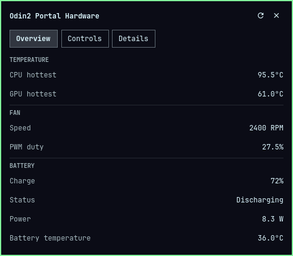

# Odin2 Portal Hardware

A native Omarchy hardware panel for the **AYN Odin 2 Portal**. It shows the
hottest CPU/GPU sensors, fan RPM and PWM duty, CPU/GPU clocks and governors,
and battery status, power and temperature.



Built on [Omarchy](https://github.com/omacom/omarchy)'s actual Commons/Ui kit.
The device-control design research credits MaSi/SteamOS-Ubuntu, Basit and
Hooandee's Panel de Control. Related Omarchy panels informed the design review;
this implementation contains no copied Decky power/fan code. See
[credits and provenance](THIRD_PARTY.md).

## Development status

Version 0.2.1 is a local development build with monitoring and **Power, Fan
and Lights** controls. Power presets use advertised Linux CPU/GPU clock steps;
they are not claimed to reproduce Android's original performance modes. Fan
control offers Auto, Manual (30–100% duty) and Maximum. Static RGB colors and
brightness can be applied to either joystick ring or both. Charge limits are
not implemented.

The target is the **Portal**, rather than every device with an ARM CPU or
Snapdragon 8 Gen 2. Other models show an unsupported-device message. Missing
readings appear as `—`; real zero readings stay zero. CPU temperature uses the
hottest relevant CPU sensor rather than averaging it with cooler components.

## Requirements

- Omarchy Quattro, Quickshell and its current Commons/Ui components.
- AYN Odin 2 Portal running Linux with the expected CPUFreq/devfreq, thermal,
  pwm-fan and battery interfaces.
- `/usr/bin/python3`, version 3.11 or newer; standard library only.

Monitoring needs no root helper. Controls require the separately installed,
root-owned local helper described below; no network service is opened. Kernel-exposed readings are not a calibration
guarantee; missing or implausible sensor values remain unavailable.

## Local development installation

The repository has not been published. Local test installation is recorded separately; see [the installation record](docs/development.md#october-20-local-portal-test-installation).
Validate a checkout before another local installation:

```sh
omarchy plugin validate .
python3 -B -m unittest discover -s tests -v
python3 -B tests/qml_smoke.py
```

For a deliberate local installation, copy the source directory into
`~/.config/omarchy/plugins/io.github.techluddite.odin2-portal-hardware/`, excluding
`.git`, `private` and development previews. Then:

```sh
omarchy-shell shell rescanPlugins
omarchy plugin enable io.github.techluddite.odin2-portal-hardware
```

The widget belongs in the bar's right section by default. Left-click opens the
panel; right-click refreshes. Escape closes the panel. **Overview**, **Controls** and **Details** separate summary values, hardware
controls, per-policy CPU/GPU readings and named thermal sensors. The body scrolls when available screen height requires it.

The shared service refreshes every 15 seconds with panels closed and every
three seconds while a panel is open or this plugin holds a hardware lease. Opening it cannot alter hardware settings.
On a read failure, the panel marks retained readings as stale and reports the
error. The reader has a five-second timeout; disabling/removing the plugin
ends monitoring and expires the control lease.

## Hardware helper and recovery

Review [the security boundary](SECURITY.md) and the source under `system/` and
`backend/controls.py`, then install explicitly on the Portal:

```sh
sudo python3 -I -B system/install-helper.py --user "$USER"
```

This copies a fixed file list to `/usr/local/lib/odin2-portal-hardware/`, owned
by root, and enables only `odin2-portal-hardware.service`. The daemon validates
the exact board, CPU topology, governors, clock steps, fan and multicolor LEDs.
It accepts fixed operations over a Unix socket authenticated to the configured
desktop UID. No sudoers rule or writable sysfs permissions are added. Installing
or starting the helper does not change hardware settings.

Controls acquire a session lease only when explicitly applied. Closing the popup
keeps settings active. Disabling the plugin, a shell restart, or loss of its
heartbeat restores the captured settings within 10 seconds. Suspend gaps also
release the lease; choices are not reapplied automatically on boot/resume.
**Restore previous settings** releases all owned controls. A root-owned journal
recovers partial writes or a daemon restart on the same boot, and ignores stale
journals from an earlier boot. Writes are checked by reading back the kernel.
Detected external changes are preserved rather than overwritten.

The fan follows the hottest CPU/GPU sensor in Auto mode. At 85°C, missing CPU/GPU
sensors or sustained zero RPM, it uses full speed. Fan-off is excluded. Recovery
keeps full speed while temperatures are unavailable or at least 85°C, then
restores the original duty. Existing kernel thermal protection remains intact.
A kernel thermal binding or active LED trigger prevents competing ownership.
Physical fan/color, sustained load and resume acceptance remain separate checks.

Stop and remove the helper separately when retiring the plugin:

```sh
sudo systemctl disable --now odin2-portal-hardware.service
sudo rm /etc/systemd/system/odin2-portal-hardware.service
sudo rm -r /usr/local/lib/odin2-portal-hardware
sudo systemctl daemon-reload
```

Keep `/var/lib/odin2-portal-hardware/` until recovery is confirmed. If sensors are
hot or unavailable when the helper stops, its journal and full fan duty remain;
restart the helper to finish recovery once temperatures permit. Installer backups
are under that directory's `installations/` subdirectory.

## Terminal and IPC

```sh
./bin/odin2-portal-hardware
omarchy-shell odin2-portal-hardware status
omarchy-shell odin2-portal-hardware refresh
```

The terminal command emits one JSON snapshot. `--sys-root` accepts a synthetic
sysfs directory for offline tests and remains read-only. The IPC status reports
support, freshness, reader state and errors; it does not expose other plugins.

For actual QML state/layout JSON and safe panel navigation, see
[live inspection](docs/inspection.md). Inspection does not acquire hardware
control or open a popup by itself.

## Update and remove

Once published and installed through Omarchy's Git workflow, use its ordinary
update command and review the diff:

```sh
omarchy plugin update io.github.techluddite.odin2-portal-hardware
omarchy plugin disable io.github.techluddite.odin2-portal-hardware
omarchy plugin remove io.github.techluddite.odin2-portal-hardware
```

Removing the UI expires its lease; removing the helper is a separate step above.
The helper stores recovery state, not sensor history. Normal process logging is
managed by systemd and Quickshell.

## Development, CI and media

Follow [development and acceptance](docs/development.md),
[the architecture](docs/architecture.md), [preview-media provenance](docs/media/README.md)
and [the changelog](CHANGELOG.md).

CI follows the other Luddite plugins: unit/repository tests on pushes and PRs,
then pinned Luddite Scout and marketplace security-baseline scans on main
pushes. Actions have read-only repository permissions and immutable pins.
The installed-Omarchy QML fixture is a separate local check. Configured workflows
are not evidence of hosted CI success or marketplace verification.

Preview assets render actual plugin components with synthetic sensor values in
an isolated environment. They contain no personal windows or hardware capture
and do not establish physical acceptance. Runtime code is not restyled for them.
See the [light and dark theme examples](docs/media/README.md).

Report security issues privately as described in [SECURITY.md](SECURITY.md).
MIT; see [LICENSE](LICENSE) and [THIRD_PARTY.md](THIRD_PARTY.md).
